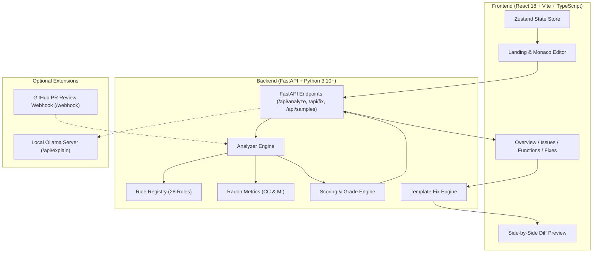

# CodeLens 🔍

> **Intelligent, deterministic Python code analysis & automated refactoring engine.**  
> Built with Python `ast`, Radon metrics, FastAPI, React 18, Monaco Editor, Tailwind CSS, and Framer Motion. Zero remote LLM API keys required.

---

## 🌟 Product Overview

**CodeLens** is a production-grade web application designed for students, software engineers, and security auditors to review Python source code instantly. 

Unlike black-box LLM wrappers, CodeLens is powered by a **100% custom, offline, deterministic analysis engine** built on Python's native abstract syntax tree (`ast`) module and Radon complexity profiling.

### Key Capabilities:
- **Instant Health Scoring (0–100 & Letter Grades A–F)** with dedicated Subscores for Security, Reliability, and Maintainability.
- **28 Modular Quality & Security Rules** covering OWASP Top 10 vulnerabilities, Python anti-patterns, and PEP 8 style principles.
- **Deterministic Auto-Fix Engine** with side-by-side interactive diff preview and syntax validation.
- **Deep Function Profiling** computing Cyclomatic Complexity, Cognitive Complexity, maximum nesting depth, and parameter counts.
- **Interactive Monaco Workspace** with squiggle decorations, line jump animations, and real-time scanning feedback.
- **Optional Local AI Assistance (Ollama)** for contextual explanation with automatic offline fallback.
- **CI/CD Integration** via GitHub Pull Request Review Webhook Bot with inline commenting.

---

## 🏛️ Architecture



---

## 📋 Comprehensive Rule Catalog (All 28 Rules)

| ID | Rule Name | Severity | Category | Description & Impact | Fixable | Reference |
| :--- | :--- | :--- | :--- | :--- | :---: | :--- |
| **S1** | `hardcoded-secret` | **Critical** | Security | Strings assigned to credentials, passwords, tokens, or AWS keys | ✅ Yes | CWE-798 / OWASP A07:2021 |
| **S2** | `sql-injection` | **Critical** | Security | Unsanitized dynamic SQL query construction via f-strings or `.format()` | ✅ Yes | CWE-89 / OWASP A03:2021 |
| **S3** | `dangerous-eval-exec` | **Critical** | Security | Arbitrary code execution vulnerability through `eval()` or `exec()` | ✅ Yes | CWE-95 / OWASP A03:2021 |
| **S4** | `shell-injection` | **High** | Security | Command injection via `subprocess.*(shell=True)` or `os.system()` | ✅ Yes | CWE-78 / OWASP A03:2021 |
| **S5** | `unsafe-deserialization` | **High** | Security | Arbitrary object instantiation via `pickle.load` or `yaml.load` | ✅ Yes | CWE-502 / OWASP A08:2021 |
| **S6** | `weak-hash` | **Medium** | Security | Collision-prone legacy hash algorithms (`hashlib.md5`, `hashlib.sha1`) | ✅ Yes | CWE-328 / OWASP A02:2021 |
| **S7** | `tls-verify-disabled` | **High** | Security | MitM risk when disabling SSL/TLS verification (`verify=False`) | ✅ Yes | CWE-295 / OWASP A07:2021 |
| **S8** | `debug-mode-enabled` | **Medium** | Security | Production debug mode exposing stack traces and interactive consoles | ❌ No | CWE-489 / OWASP A05:2021 |
| **S9** | `insecure-random` | **Low** | Security | Pseudo-random `random` module used for security-sensitive tokens/passwords | ❌ No | CWE-338 / OWASP A02:2021 |
| **B1** | `bare-except` | **Medium** | Bug | Catches system signals like `KeyboardInterrupt` and hides bugs | ✅ Yes | PEP 8 / CWE-396 |
| **B2** | `swallowed-exception` | **Medium** | Bug | Exception caught but silently discarded with `pass` | ❌ No | CWE-390 / PEP 8 |
| **B3** | `mutable-default-arg` | **High** | Bug | Mutable default arguments (`[]`, `{}`) shared across function calls | ✅ Yes | PEP 570 / Common Gotchas |
| **B4** | `none-comparison` | **Low** | Bug | Comparison to `None` using `==` / `!=` instead of identity `is` | ✅ Yes | PEP 8 |
| **B5** | `unreachable-code` | **Medium** | Bug | Statements situated after terminating `return`, `raise`, `break` | ❌ No | CWE-561 |
| **B6** | `shadowed-builtin` | **Low** | Bug | Variable or parameter overwriting builtins (`list`, `dict`, `id`, `str`) | ❌ No | PEP 8 |
| **B7** | `unused-variable` | **Low** | Bug | Local variable assigned in function scope but never referenced | ❌ No | PEP 8 |
| **B8** | `unused-import` | **Low** | Bug | Module or symbol imported into namespace but never used | ✅ Yes | PEP 8 / Flake8 F401 |
| **B9** | `missing-resource-close` | **Medium** | Bug | `open()` invoked outside of a `with` context manager | ❌ No | PEP 343 / CWE-775 |
| **M1** | `function-too-long` | **Medium** | Maintainability | Function body exceeds 50 lines (violates Single Responsibility) | ❌ No | Clean Code |
| **M2** | `deep-nesting` | **Medium** | Maintainability | Control nesting depth exceeds 4 levels (arrow anti-pattern) | ❌ No | Refactoring |
| **M3** | `too-many-parameters` | **Low** | Maintainability | Function accepts more than 5 parameters | ❌ No | Clean Code |
| **M4** | `high-complexity` | **High / Medium**| Maintainability | Cyclomatic complexity > 10 (Medium) or > 15 (High) | ❌ No | McCabe Complexity |
| **M5** | `missing-docstring` | **Low** | Style | Public function or class lacking a descriptive docstring | ❌ No | PEP 257 |
| **M6** | `magic-number` | **Low** | Style | Unexplained numeric literal in comparison or logical condition | ❌ No | Clean Code |
| **M7** | `duplicate-code` | **Medium** | Maintainability | Duplicate code blocks (5+ continuous lines) violating DRY | ❌ No | DRY Principle |
| **M8** | `todo-comment` | **Low** | Style | Lingering `TODO`, `FIXME`, or `HACK` technical debt tags | ❌ No | Technical Debt |
| **M9** | `print-statement` | **Low** | Style | Direct `print()` call instead of configurable standard logging | ❌ No | 12-Factor App |
| **M10**| `naming-convention` | **Low** | Style | Inconsistent naming: functions not `snake_case` or classes not `PascalCase`| ❌ No | PEP 8 |

---

## 🧮 Scoring Formula & Grade Scale

CodeLens calculates code health using a deterministic, penalty-based formula with size normalization and complexity penalties:

$$\text{Total Penalty} = \sum_{\text{rules}} \min\left(\sum \text{Issue Penalties}, 30\right) + \min\left(10, \sum_{\text{functions}} \max(0, \text{CC} - 10)\right)$$

### 1. Penalty Weights by Severity:
- **Critical**: 15.0 points
- **High**: 8.0 points
- **Medium**: 4.0 points
- **Low**: 1.5 points

### 2. Rule Capping & Normalization:
- **Rule Cap**: Penalties for any single rule ID are capped at **30 points**, ensuring repetitive minor issues (such as multiple print statements) do not unfairly reduce the overall score to zero.
- **Size Normalization**: For large files (>300 lines), penalties are scaled by $\max(0.5, \frac{300}{\text{Lines}})$.

### 3. Final Score & Letter Grade:
$$\text{Score} = \text{clamp}(100 - \text{Total Penalty}, 0, 100)$$

| Grade | Health Score Range | Evaluation |
| :---: | :---: | :--- |
| **A** | **90 – 100** | Production-ready, well-structured, secure |
| **B** | **75 – 89** | High quality with minor refactoring suggestions |
| **C** | **60 – 74** | Moderate technical debt or non-critical issues |
| **D** | **40 – 59** | Needs refactoring; potential reliability issues |
| **F** | **0 – 39** | Critical vulnerabilities or structural flaws present |

---

## 🛠️ How to Add a New Rule in 1 File

Creating a new rule requires zero boilerplate. Simply create a file in `backend/app/rules/` and use the `@registry.register` decorator:

```python
# backend/app/rules/my_custom_rule.py
import ast
from typing import List
from app.models import Issue
from app.rules.base import BaseRule, registry

@registry.register
class AssertUsedRule(BaseRule):
    rule_id = "assert-used"
    title = "Use of assert in Production Code"
    severity = "medium"
    category = "bug"
    why_it_matters = "Assert statements are removed when Python is run with optimizations (-O flag)."
    suggestion = "Raise an explicit ValueError or custom exception instead of assert."
    reference = "CWE-617 / Python Security"
    fixable = False

    def check(self, tree: ast.AST, source_code: str, source_lines: List[str]) -> List[Issue]:
        issues = []
        for node in ast.walk(tree):
            if isinstance(node, ast.Assert):
                issues.append(self.create_issue(
                    message="Production assertion found; can be bypassed with python -O.",
                    line=node.lineno,
                    column=node.col_offset,
                ))
        return issues
```

Import your module in `backend/app/rules/__init__.py` and the rule is automatically available in the API, analysis engine, and UI!

---

## 🚀 Run Instructions

### Prerequisites
- **Python 3.10+**
- **Node.js 18+ & npm**

### 1. Start the Backend API:
```bash
cd backend
python3 -m venv .venv
source .venv/bin/activate
pip install -r requirements.txt
uvicorn app.main:app --reload --port 8000
```
*API will run at `http://localhost:8000` (interactive Swagger docs at `http://localhost:8000/docs`).*

### 2. Start the Frontend App:
```bash
cd frontend
npm install
npm run dev
```
*Web application will open at `http://localhost:5173`.*

### 3. Run Pytest Suite:
```bash
# From repository root
PYTHONPATH=backend:./ pytest backend/tests/ -v
```

---

## 📸 Screenshots

*(Visual layout representation)*

```
┌────────────────────────────────────────────────────────────────────────┐
│ [CodeLens Logo]  Sample: [terrible.py ▾]  [Upload .py]  [Analyze Code] │
├──────────────────────────────────┬─────────────────────────────────────┤
│ MONACO CODE EDITOR               │ ANALYSIS DASHBOARD                  │
│                                  │ [Overview] [Issues: 28] [Functions] │
│ 10 api_key = "AKIA12..."         │                                     │
│    ~~~~~~~~~~~~~~~~~~~~~         │          ┌──────────┐               │
│ 17 def ProcessUserData(...,      │          │  Score   │  Grade F      │
│            tags=[]):             │          │    0     │               │
│            ~~~~~~~               │          └──────────┘               │
│ 33 except:                       │ Security: 0/100  Reliability: 35/100│
│    ~~~~~~                        │                                     │
│ 37 subprocess.run("...",         │ Issues by Severity:                 │
│                   shell=True)    │ 🔴 Critical: 3  🟠 High: 4  🟡 Med: 8│
│                                  │                                     │
│ [Scanning Beam Animation]        │ [Fix All Safe Issues Button]        │
└──────────────────────────────────┴─────────────────────────────────────┘
```

---

## 🤖 Optional Extensions

### 1. Local AI Explanations via Ollama
CodeLens can optionally generate localized explanations using Ollama with a 20-second timeout and automatic fallback:
```bash
# Pull model and start Ollama
ollama pull qwen2.5-coder:1.5b
ollama serve
```
Click **"Explain with AI"** on any issue card in the Issues tab for deep security commentary.

### 2. GitHub PR Review Webhook Bot
To automatically comment on pull requests in GitHub:
```bash
# Start bot webhook server
python3 github_bot/bot.py

# In another terminal, expose via ngrok
ngrok http 8080
```
Set webhook URL to `https://<your-ngrok-url>/webhook` with `pull_request` events enabled in your GitHub repository settings. Set `GITHUB_TOKEN` to post live comments, or leave blank for console dry-run mode.

---

## 🔮 Future Scope & Roadmap

- **Multi-File Workspace Support**: Analyze full directory trees and zip uploads with inter-file dependency resolution.
- **Custom Lint Config (.codelens.yaml)**: Allow teams to enable/disable rules and customize severity thresholds per repository.
- **VS Code Extension**: Bring the CodeLens deterministic rules and gutter markers directly into Visual Studio Code.
- **Multi-Language Expansion**: Add parsers for TypeScript/JavaScript (using Babel/SWC) and Go (using `go/ast`).
